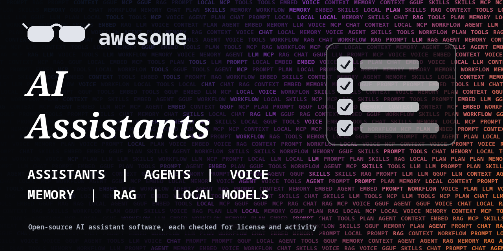

<h1 align="center">Awesome AI Assistants</h1>

> Open-source AI assistants, chat apps, voice assistants, agent frameworks, memory and local model tools. Every entry shows its license.

**Rules of this list:** every repo exists, is public, is not archived, states a license and has had a commit in the last year. One plain sentence each. Star counts and claims are the authors' own, we did not test every tool. Checked 2026-10-18. See [CONTRIBUTING.md](CONTRIBUTING.md).

## Contents

- [Personal assistants](#personal-assistants)
- [Chat apps and UIs](#chat-apps-and-uis)
- [Agent frameworks](#agent-frameworks)
- [MCP servers and tool use](#mcp-servers-and-tool-use)
- [Memory, RAG and knowledge](#memory-rag-and-knowledge)
- [Voice assistants](#voice-assistants)
- [Local models and inference](#local-models-and-inference)
- [Browser and computer-use agents](#browser-and-computer-use-agents)
- [Evaluation, prompts and observability](#evaluation-prompts-and-observability)
- [How to choose](#how-to-choose)
- [Contributing](#contributing)

## Personal assistants

Assistants you run and own.

- [home-assistant/core](https://github.com/home-assistant/core)  - Open-source home automation that puts local control first. _(Apache-2.0)_
- [khoj-ai/khoj](https://github.com/khoj-ai/khoj)  - Self-hostable AI second brain that searches your notes and the web. _(AGPL-3.0)_
- [mem0ai/mem0](https://github.com/mem0ai/mem0)  - Memory layer for AI assistants and agents. _(Apache-2.0)_
- [openinterpreter/openinterpreter](https://github.com/openinterpreter/openinterpreter)  - Natural language interface that runs code on your computer. _(Apache-2.0)_
- [Significant-Gravitas/AutoGPT](https://github.com/Significant-Gravitas/AutoGPT)  - Platform for building and running AI agents that automate work. _(check repo)_

## Chat apps and UIs

Front ends for many models.

- [janhq/jan](https://github.com/janhq/jan)  - Offline ChatGPT alternative that runs on your computer. _(check repo)_
- [LibreChat-AI/LibreChat](https://github.com/LibreChat-AI/LibreChat)  - Self-hosted chat app that works with many AI providers. _(MIT)_
- [lobehub/lobehub](https://github.com/lobehub/lobehub)  - Modern chat framework with plugins and multiple providers. _(check repo)_
- [Mintplex-Labs/anything-llm](https://github.com/Mintplex-Labs/anything-llm)  - All-in-one app to chat with documents using any model. _(MIT)_
- [oobabooga/textgen](https://github.com/oobabooga/textgen)  - Web UI for running large language models locally. _(AGPL-3.0)_
- [open-webui/open-webui](https://github.com/open-webui/open-webui)  - Self-hosted web interface for local and hosted language models. _(check repo)_

## Agent frameworks

Build agents that use tools and plan steps.

- [crewAIInc/crewAI](https://github.com/crewAIInc/crewAI)  - Framework for orchestrating role-playing AI agents. _(MIT)_
- [FoundationAgents/MetaGPT](https://github.com/FoundationAgents/MetaGPT)  - Multi-agent framework that plays software company roles. _(MIT)_
- [huggingface/smolagents](https://github.com/huggingface/smolagents)  - Small library for agents that write code to act. _(Apache-2.0)_
- [langchain-ai/langchain](https://github.com/langchain-ai/langchain)  - Framework for building applications with language models. _(MIT)_
- [langchain-ai/langgraph](https://github.com/langchain-ai/langgraph)  - Library for building stateful, multi-step agents as graphs. _(MIT)_
- [langgenius/dify](https://github.com/langgenius/dify)  - Platform for building LLM apps with workflows and RAG. _(check repo)_
- [microsoft/autogen](https://github.com/microsoft/autogen)  - Framework for building multi-agent AI applications. _(CC-BY-4.0)_
- [openai/openai-agents-python](https://github.com/openai/openai-agents-python)  - Lightweight Python framework for multi-agent workflows. _(MIT)_
- [OpenHands/OpenHands](https://github.com/OpenHands/OpenHands)  - Platform for AI software development agents. _(MIT)_
- [pydantic/pydantic-ai](https://github.com/pydantic/pydantic-ai)  - Agent framework from the Pydantic team with typed outputs. _(MIT)_
- [run-llama/llama_index](https://github.com/run-llama/llama_index)  - Data framework for connecting language models to your data. _(MIT)_

## MCP servers and tool use

Connect assistants to apps and data. Read what a server can access before you connect it.

- [github/github-mcp-server](https://github.com/github/github-mcp-server)  - GitHub's official MCP server. _(MIT)_
- [microsoft/playwright-mcp](https://github.com/microsoft/playwright-mcp)  - MCP server that lets assistants drive a browser with Playwright. _(Apache-2.0)_
- [modelcontextprotocol/python-sdk](https://github.com/modelcontextprotocol/python-sdk)  - Official Python SDK for the Model Context Protocol. _(MIT)_
- [modelcontextprotocol/servers](https://github.com/modelcontextprotocol/servers)  - Reference collection of Model Context Protocol servers. _(check repo)_
- [modelcontextprotocol/typescript-sdk](https://github.com/modelcontextprotocol/typescript-sdk)  - Official TypeScript SDK for the Model Context Protocol. _(check repo)_
- [PrefectHQ/fastmcp](https://github.com/PrefectHQ/fastmcp)  - Fast, Pythonic way to build MCP servers and clients. _(Apache-2.0)_

## Memory, RAG and knowledge

Give an assistant your documents and long-term memory.

- [chroma-core/chroma](https://github.com/chroma-core/chroma)  - Open-source database for embeddings and retrieval. _(Apache-2.0)_
- [HKUDS/LightRAG](https://github.com/HKUDS/LightRAG)  - Simple and fast retrieval-augmented generation. _(MIT)_
- [infiniflow/ragflow](https://github.com/infiniflow/ragflow)  - RAG engine focused on deep document understanding. _(Apache-2.0)_
- [letta-ai/letta](https://github.com/letta-ai/letta)  - Framework for agents with long-term memory, formerly MemGPT. _(Apache-2.0)_
- [milvus-io/milvus](https://github.com/milvus-io/milvus)  - Cloud-native vector database for similarity search. _(Apache-2.0)_
- [pgvector/pgvector](https://github.com/pgvector/pgvector)  - Vector similarity search for Postgres. _(check repo)_
- [qdrant/qdrant](https://github.com/qdrant/qdrant)  - Vector database and search engine written in Rust. _(Apache-2.0)_
- [weaviate/weaviate](https://github.com/weaviate/weaviate)  - Open-source vector database. _(check repo)_

## Voice assistants

Speech in and out, wake words, home use.

- [ggml-org/whisper.cpp](https://github.com/ggml-org/whisper.cpp)  - Port of Whisper in C and C++ for fast local transcription. _(MIT)_
- [OHF-Voice/wyoming](https://github.com/OHF-Voice/wyoming)  - Peer-to-peer protocol for voice assistants, used by Home Assistant. _(MIT)_
- [openai/whisper](https://github.com/openai/whisper)  - General-purpose speech recognition model. _(MIT)_
- [OpenVoiceOS/ovos-core](https://github.com/OpenVoiceOS/ovos-core)  - Community-driven open voice assistant platform. _(Apache-2.0)_
- [SYSTRAN/faster-whisper](https://github.com/SYSTRAN/faster-whisper)  - Faster Whisper transcription using CTranslate2. _(MIT)_

## Local models and inference

Run models on your own machine.

- [ggml-org/llama.cpp](https://github.com/ggml-org/llama.cpp)  - LLM inference in C and C++ on many kinds of hardware. _(MIT)_
- [lm-sys/FastChat](https://github.com/lm-sys/FastChat)  - Platform for training, serving and evaluating chat models. _(Apache-2.0)_
- [LostRuins/koboldcpp](https://github.com/LostRuins/koboldcpp)  - Single-file way to run GGUF models locally. _(AGPL-3.0)_
- [mlc-ai/mlc-llm](https://github.com/mlc-ai/mlc-llm)  - Run language models on phones, browsers and laptops. _(Apache-2.0)_
- [mudler/LocalAI](https://github.com/mudler/LocalAI)  - Self-hosted OpenAI-compatible API for local models. _(MIT)_
- [ollama/ollama](https://github.com/ollama/ollama)  - Run large language models locally. _(MIT)_
- [vllm-project/vllm](https://github.com/vllm-project/vllm)  - Fast and easy-to-use library for LLM inference and serving. _(Apache-2.0)_

## Browser and computer-use agents

Agents that operate a browser or desktop.

- [browser-use/browser-use](https://github.com/browser-use/browser-use)  - Make websites accessible for AI agents. _(MIT)_
- [bytedance/UI-TARS-desktop](https://github.com/bytedance/UI-TARS-desktop)  - Desktop app and agent stack for controlling a computer with a vision model. _(Apache-2.0)_
- [microsoft/OmniParser](https://github.com/microsoft/OmniParser)  - Screen parsing tool for GUI agents. _(CC-BY-4.0)_
- [simular-ai/Agent-S](https://github.com/simular-ai/Agent-S)  - Open agentic framework that uses computers like a human. _(Apache-2.0)_
- [Skyvern-AI/skyvern](https://github.com/Skyvern-AI/skyvern)  - Automate browser workflows with LLMs and computer vision. _(AGPL-3.0)_

## Evaluation, prompts and observability

Test and monitor assistants.

- [Arize-ai/phoenix](https://github.com/Arize-ai/phoenix)  - AI observability and evaluation. Source-available license. _(check repo)_
- [confident-ai/deepeval](https://github.com/confident-ai/deepeval)  - Evaluation framework for LLM apps. _(Apache-2.0)_
- [langfuse/langfuse](https://github.com/langfuse/langfuse)  - Open-source LLM engineering platform with tracing and evals. _(check repo)_
- [promptfoo/promptfoo](https://github.com/promptfoo/promptfoo)  - Test prompts, agents and RAG, and red-team models. _(MIT)_
- [vibrantlabsai/ragas](https://github.com/vibrantlabsai/ragas)  - Toolkit to evaluate RAG pipelines. _(Apache-2.0)_

## How to choose

- **Know where your data goes.** Local models keep data on your machine, hosted APIs do not.
- **Limit tool access.** Give an agent only the folders, accounts and keys it needs.
- **Check the license.** Model weights often have their own terms.
- **Expect change.** This field moves fast, so look at the last commit.

## Contributing

See [CONTRIBUTING.md](CONTRIBUTING.md). One entry per pull request, plain words, real sources only.

## About

Maintained by [@devanasolver](https://github.com/devanasolver). Listings follow the rules in CONTRIBUTING.

## Sponsor me

If this list is useful, [buy me a coffee](https://buymeacoffee.com/isaac49).
